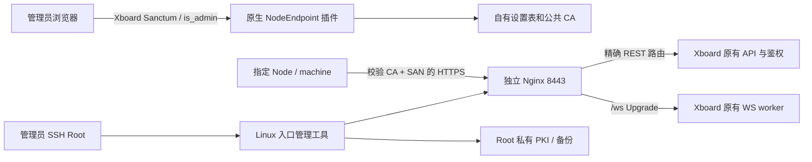

# NodeEndpoint 技术架构

## 三个权限域

Web 进程无 Root 权限、不执行命令、不持有 CA 或服务器私钥。Root 管理器与 Node 工具由管理员通过 SSH 独立执行。公开 CA 与状态快照可以导入页面；它们不构成自动部署通道。

## 原生插件

`Plugin\NodeEndpoint` 遵守官方 `AbstractPlugin`、`config.json`、routes、migration、boot/install/update/cleanup。自己的设置存放 `node_endpoint_settings` 单行 JSON，使用宿主数据库连接；普通插件配置只有管理入口说明，避免宿主无业务校验配置保存接口绕过 HTTP 风险确认。

所有管理 API 在 `/api/v1/node-endpoint/*`，使用宿主 `api`、`admin` 和独立 `Enabled` middleware。数据 API 每次读取原生插件启用状态；常驻 worker 中保留的旧 route 也会拒绝访问。独立 `/node-endpoint` 是公共登录壳，敏感数据全部由原生 Sanctum 的管理员 API 返回。页面 CSP 仅允许同源，资产由自己的扩展名隐藏路由返回。没有第三方 JavaScript 或持久 Token 存储。

## 请求局部 WebSocket 地址

官方 handshake 没有 filter hook，固定 `server_ws_url` 可能指向旧域名。boot 通过 router 将独立 response middleware 去重加入 `api` group。仅官方 `ServerController@handshake`、精确 URI、成功 JSON 响应、插件启用和配置有效、目标 host/port/HTTPS 与新入口匹配时处理返回。原生 WebSocket enabled/heartbeat 条件保持；启用时只改 `ws_url`，REST 模式只对新入口返回 `enabled=false`。

不写全局 `server_ws_url`，不替换 Controller，不修改旧入口响应。Root 代理设置正确 Host、X-Forwarded-Host/Port/Proto，并禁用含凭据的 access log。自定义 proxy / TrustProxies 配置仍需真实环境验收。

## 根证书与入口

Root 状态与 PKI 默认置于网站目录以外的专用目录，CA 私钥使用 AES-256 加密并支持离线导出/匹配验证/移除在线副本。服务器密钥为新生成的 EC P-256，Root-only 权限。签发使用显式 ASN.1 时间、CA Basic Constraints / Key Usage、服务器 EKU 与 IP/DNS SAN。

Nginx 配置为独立受所有权约束文件。只允许审计并由实际 `route:list` 确认的 V1 UniProxy / V2 server / machine 路由及 `/ws`；其他路径拒绝。变更先快照，验证配置被实际 include 加载，执行配置测试后 reload；失败尝试恢复，保留恢复证据。详情见 PANEL_TOOL。

## Node 工具

配置解析器仅接受审计过的 YAML 子集，保留源文本位置，修改指定 `panel.url` 单一 scalar 后再次比较全量语义。采用严格实例标识、原 URL、元数据与服务校验；不同实例的绑定、目录与 Token 保持。验证 CA 指纹后先通过 HTTPS REST 身份认证；备份并停止服务后再验证 WSS 101/accept 与匹配身份的 `auth.success`，明确 REST fallback 状态。官方认证 WS 有注册连接/清理设备状态的副作用，服务启动后避免重复探测业务身份。

新实例二进制来自独立 Node 固定 release 和内置摘要；迁移不下载或替换二进制。每服务私有 trust bundle 合并原系统根，避免破坏其他可信站点。systemd 写入与启动失败有备份恢复路径。Docker / 自定义 unit / 不明确环境覆盖为 V1 安全拒绝范围。

## 共存与恢复

插件不改 Admin bundle、现有插件资源/锁/配置、机器绑定或 FlowScope 数据。cleanup 无副作用，原生卸载保留自己的恢复状态，显式 purge 与 Root 卸载分离。单元测试、真实 Laravel 组件测试、本地 TLS 协议 fixture 与真实 Linux/Go 部署具有不同证据范围，详见 TEST_REPORT。
